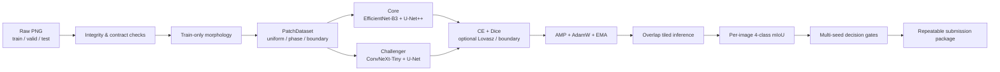
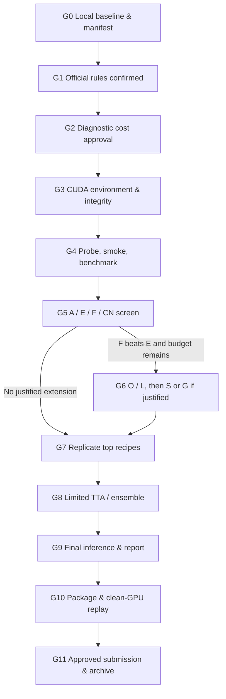

<div align="center">

# ALPHASE

### Aluminum Phase Segmentation for KoMaP AI 2026

작은 데이터에서도 희소한 조직과 경계를 놓치지 않도록 설계한 4상 의미론적 분할 파이프라인

[Overview](#overview) · [Architecture](#architecture) · [Competition Strategy](#competition-strategy) · [Quick Start](#quick-start) · [Reliability](#reliability) · [Roadmap](#roadmap) · [Documentation](#documentation)


</div>

## Overview

**ALPHASE**는 2026 KoMaP AI 대회의 알루미늄 합금 광학현미경 이미지에서 `Primary Si`, `Al3Ni`, `Eutectic Si`, `Al`을 픽셀 단위로 분할하기 위한 대회용 연구·실행 시스템이다.

이 저장소는 단일 모델 구현을 넘어 데이터 무결성 검사, 재현 가능한 학습, 이미지별 mIoU 평가, 타일 추론, 제한된 앙상블, 제출물 검증과 clean-environment 재실행까지 하나의 흐름으로 묶는다. 공식 `train 70 / valid 20 / test 10` 분할을 보존하며 validation과 test를 학습 데이터로 사용하지 않는다.

> `champion.json`은 현재의 **주력 설계안**을 뜻한다. 아직 GPU 본학습이나 대회 validation 성능 측정이 완료된 모델, 우승이 입증된 모델이라는 뜻은 아니다.

### The challenge

| 제약 | ALPHASE의 대응 |
|---|---|
| 학습 이미지가 70장으로 적음 | 강한 공간 증강, patch 학습, EMA, 제한된 후보 비교 |
| 이미지마다 해상도가 다름 | 원본 비율을 유지한 crop 학습과 overlap tiled inference |
| 작은 Eutectic Si 성분이 매우 많음 | train-only morphology와 component-aware sampling 후보 |
| 상 경계가 가늘고 복잡함 | U-Net++, 경계 진단, 조건부 boundary loss |
| 공식 평가는 이미지별 4상 mIoU | per-image metric, 상별 IoU, absent-class 정책 분리 |
| 작은 표본에서 선택 편향이 큼 | 부모 대조군, 3-seed 확인, paired 비교와 보수적 채택 gate |
| GPU 임대 환경은 중단될 수 있음 | self-contained checkpoint, 완료 run 보호, hash 기반 provenance |

### Design principles

| 원칙 | 의미 |
|---|---|
| **Evidence before complexity** | 실제 train 관측에서 출발한 가설만 독립 후보로 실험한다. |
| **One change at a time** | sampler, loss, attention, boundary 항목을 한꺼번에 켜지 않는다. |
| **Metric alignment** | crop loss만 보지 않고 원본 크기의 이미지별 mIoU로 선택한다. |
| **Reproducibility by default** | source, config, data, checkpoint, cache를 hash와 fingerprint로 연결한다. |
| **Submission over endless search** | 비슷한 점수라면 단순하고 재현 가능한 구성을 선택한다. |

## Architecture



### Model portfolio

| ID | 모델 또는 단일 변경 | 역할 | 파라미터 |
|---|---|---|---:|
| A | ResNet34 + U-Net + CE | 최소 복잡도의 baseline | 설정 기반 측정 |
| E | EfficientNet-B3 + U-Net++ + CE/Dice, uniform sampling | Core 구조 대조군 | 13,625,228 |
| F | E + phase/boundary sampling | 현재 주력 recipe | 13,625,228 |
| O | F + component-uniform phase sampling | 작은 Eutectic Si 노출 가설 | 13,625,228 |
| L | F + per-image Lovasz-Softmax | IoU 정렬 목적함수 가설 | 13,625,228 |
| S | F + decoder scSE | 특징 재가중 가설 | 13,715,677 |
| G | F + classwise boundary loss | 경계 오류가 확인될 때의 후보 | 13,625,228 |
| CN | ConvNeXt-Tiny + U-Net | 다른 표현 계열 및 앙상블 후보 | 31,929,188 |

### Why this scale

70장의 학습 데이터에서 대형 foundation model을 무제한 탐색하는 대신, 검증 가능한 encoder-decoder와 데이터 특성에 맞춘 sampling/loss를 우선한다. 거대 모델이 항상 불리하다는 뜻이 아니라, 현재 데이터·예산·마감 조건에서는 **비교 가능한 가설과 안정적인 제출**이 더 높은 우선순위라는 판단이다.

## Competition Strategy

### 1. Data-grounded hypothesis

70장 train mask만 분석한 결과, Eutectic Si는 8-connected 성분 63,393개 중 69.10%가 64 pixel 이하였고, 이 작은 성분들이 해당 상 픽셀의 23.40%를 차지했다. 반면 Primary Si의 64 pixel 이하 성분 비중은 3.18%였다.

이 관측으로부터 기존 phase-pixel sampling이 큰 성분을 더 자주 고르는 편향을 가질 수 있다고 보고, **성분을 먼저 균등 선택하는 O 후보**를 만들었다. 이 수치는 물리적으로 독립된 입자 수나 실제 면적을 뜻하지 않으며, O가 mIoU를 높인다는 결론도 아니다. 효과는 F→O 단일 변경 실험으로 검증한다.

### 2. Objective and sampling

- 기본 목적함수: `0.5 × CE + 0.5 × image-present Dice`
- L 후보: 기본 목적함수에 `0.2 × per-image Lovasz-Softmax` 추가
- G 후보: F에 classwise boundary loss `0.05` 추가
- 기본 crop 비율: `60% uniform / 25% phase / 15% boundary`
- O 후보: phase branch에서 class → connected component → component pixel 순으로 균등 선택
- EMA: 학습 가중치와 별도로 평가용 지수 이동 평균 가중치 유지

### 3. Experiment ladder



초기 screen은 같은 조건의 `A / E / F / CN`, seed 42로 시작한다. 후보 확장은 F가 E를 통과하고 시간·비용이 남을 때만 진행한다. 상위 최대 2개 recipe와 결론에 필요한 부모 대조군을 seeds `42 / 123 / 2026`으로 반복한다.

증분 변경의 내부 채택 기준은 동일 source/config/data/budget에서 seed 평균 `+0.005 mIoU` 이상, 각 seed와 클래스의 IoU 하락 `0.02` 이내, 다수 seed 개선이다. 이는 선택을 보수적으로 만들기 위한 내부 규칙이며 통계적 유의성이나 수상 가능성을 보장하지 않는다.

### 4. Inference and selection

- 원본 해상도에서 overlap tile의 softmax 확률을 합성한다.
- 최종 후보가 정해진 뒤에만 `none / flip / D4` TTA를 비교한다.
- 앙상블은 최대 3개 모델의 확률 평균으로 제한한다.
- validation 차이가 불확실하면 더 단순하고 빠른 구성을 우선한다.
- test 이미지는 최종 출력 생성에만 사용하며 모델 선택이나 pseudo-label 학습에 사용하지 않는다.

## Data Contract

```text
data/
├── train/
│   ├── images/*_image.png
│   └── masks/*_mask.png
├── valid/
│   ├── images/*_image.png
│   └── masks/*_mask.png
└── test/
    └── images/*_image.png
```

| ID | Phase | RGB |
|---:|---|---|
| 0 | Primary Si | `76, 178, 76` |
| 1 | Al3Ni | `25, 76, 153` |
| 2 | Eutectic Si | `204, 204, 204` |
| 3 | Al | `153, 127, 76` |

`inspect`는 파일 수, image-mask pairing, shape, palette, alpha, unknown color, split 간 정확 중복을 검사한다. 현재 확인된 원본은 입력과 GT를 합쳐 PNG 190개이며 저장된 archive의 PNG byte SHA와 일치한다. 원본 데이터와 mask는 Git 저장소에 포함하지 않는다.

## Quick Start

### Requirements

- Python 3.10 이상
- PyTorch 2.7 이상과 torchvision 0.22 이상
- CUDA 학습 시 해당 GPU와 driver에 맞는 공식 PyTorch build
- Linux GPU 환경에서는 Windows `.venv`를 복사하지 않고 새 환경을 만든다.

### Install

CUDA용 `torch`와 `torchvision`은 먼저 [PyTorch 공식 설치 안내](https://pytorch.org/get-started/locally/)에서 GPU·driver에 맞는 명령으로 설치한다.

```bash
python -m venv .venv
source .venv/bin/activate
python -m pip install --upgrade pip
python -m pip install -r requirements.txt
python -m pip install -e . --no-deps
python -m pip check
```

Windows PowerShell에서는 생성된 환경을 `./.venv/Scripts/Activate.ps1`로 활성화하거나, 저장소의 `./activate.ps1`을 사용한다.

### Local verification — no GPU training

```bash
python -m unittest discover -s tests -v
python -m alphase inspect \
  --data ../data \
  --official-counts \
  --output runs/preflight_v4/data_report.json
```

### Build an experiment plan

다음 명령은 계획 파일만 만들고 학습하지 않는다.

```bash
python -m alphase experiment-plan \
  --config configs/champion.json \
  --ids A E F CN \
  --seeds 42 \
  --output plans/screen_v4
```

실제 `experiments`, `train`, `tune`, `benchmark`는 공식 규정 확인, CUDA 환경 검사, 지출 한도 승인 후 [단계별 행동 지침](docs/ACTION_GUIDE.md)의 G0→G11 순서로 실행한다.

### Core CLI

| Command | Purpose |
|---|---|
| `inspect` | 데이터 구조·색상·중복·해시 검사 |
| `morphology` | train-only connected-component 통계 생성 |
| `tune` | GPU patch/batch 메모리 probe |
| `benchmark` | 실제 crop 기반 학습 시간 측정 |
| `train` | 단일 recipe 학습 및 안전한 resume |
| `experiment-plan` | 공정한 ablation plan 생성 |
| `experiments` | 계획에 따른 학습·평가·비교 실행 |
| `evaluate` | 원본 크기 지표·패널·확률 cache 생성 |
| `ensemble-search` | 고정된 cache에서 제한된 가중치 탐색 |
| `infer` | test prediction 생성 |
| `validate-output` | 파일명·크기·palette·alpha·개수 검사 |
| `repeat-check` | 동일 명세 재추론과 PNG hash 대조 |
| `package` | 보고서·코드·환경·가중치·예측 패키징 |
| `verify-package` | 압축 해제 후 독립 재실행 검증 |
| `budget` | 실측 epoch 시간과 시간당 요금으로 비용 추정 |

전체 옵션은 다음 명령에서 확인할 수 있다.

```bash
python -m alphase --help
python -m alphase <command> --help
```

## Reliability

ALPHASE는 좋은 validation 점수뿐 아니라 **그 점수가 어떤 코드·데이터·가중치에서 나왔는지**를 보존하는 것을 모델 설계의 일부로 취급한다.

| Failure mode | Guardrail |
|---|---|
| 완료된 run을 실수로 다시 학습 | `completed`와 `stop_reason`을 확인하고 일치 run은 재사용 |
| 중단 시 best/history 유실 | `last.pt`에 최고 EMA, epoch, metrics, 전체 history 포함 |
| 다른 설정으로 잘못 resume | source/data/config/steps fingerprint 불일치 시 거부 |
| stale evaluation/cache 혼합 | checkpoint SHA, inference fingerprint, input/GT hash 대조 |
| 일부 seed만 끝난 후보 추천 | 누락 seed·부모 대조군·budget mismatch 후보 제외 |
| 잘못된 PNG와 모델 패키징 | contract와 manifest 검사 후 동일 환경 반복 추론 |
| 합성 smoke 점수를 성능으로 오인 | smoke/partial run을 추천 대상에서 제외 |

평가는 전체 mIoU 외에 class IoU, precision/recall, FP/FN, boundary F1, 작은 GT 조직 recall, 2D phase-area fraction MAE를 기록한다. absent-class의 공식 처리 방식은 확정 전까지 `exclude / zero / one`을 분리해 기록하며, 확인되지 않은 정책을 공식 점수로 주장하지 않는다.

## Technology

| Layer | Technology |
|---|---|
| Training | PyTorch 2.7+, AMP, AdamW, EMA |
| Segmentation | segmentation-models-pytorch 0.5.0 |
| Encoders | timm EfficientNet-B3, ConvNeXt-Tiny |
| Data | NumPy, Pillow, SciPy ndimage |
| Metrics | image-wise mIoU, paired bootstrap diagnostics |
| Artifacts | JSON, CSV, HTML, PNG, NPZ, SHA-256 manifest |
| Packaging | inference-only weights, environment spec, report, verified predictions |
| Tests | Python `unittest`, synthetic fixtures, workflow regression |

## Repository Layout

```text
ALPHASE/
├── alphase/                    # 데이터·모델·학습·평가·패키징 코드
│   ├── data.py                 # 데이터 계약, dataset, augmentation
│   ├── models.py               # segmentation model factory
│   ├── sampling.py             # uniform/phase/boundary/component sampler
│   ├── losses.py               # CE, Dice, Tversky, Lovasz, boundary loss
│   ├── engine.py               # train, EMA, checkpoint, resume
│   ├── inference.py            # tiled inference, TTA, ensemble
│   ├── metrics.py              # mIoU와 상세 진단 지표
│   ├── experiments.py          # ablation plan, runner, selection gates
│   └── submission.py           # output validation과 package replay
├── configs/                    # baseline, champion, challenger, O/L/S 후보
├── docs/                       # 설계, 실행, 검증, 복구, 파일별 계약
├── tests/                      # 53개 CPU 회귀 테스트
├── runs/                       # 저장된 비학습 분석 결과만 Git 추적
├── ALPHASE_Colab.ipynb         # GPU 작업용 notebook 진입점
├── SOURCE_SHA256.json          # 직접 관리 소스의 무결성 manifest
└── pyproject.toml              # alphase 0.4.0 package metadata
```

세부 파일 역할은 [폴더·파일 지도](docs/FILE_MAP.md), 각 Python 모듈의 입력·출력·불변 조건은 [`docs/modules`](docs/modules)에서 확인할 수 있다.

## Project Status

**기준일: 2026-10-11 KST**

### Verified

- CPU 환경에서 53개 고유 회귀 테스트 통과
- 실제 데이터 `train 70 / valid 20 / test 10`, PNG 190개 무결성 확인
- Core/O/L/S의 실제 128×128 crop forward, finite loss와 gradient 확인
- Core 13,625,228 / scSE 13,715,677 / CN 31,929,188 파라미터 측정
- self-contained resume, 완료 run hash 불변, cache provenance 검사 구현
- 합성 fixture에서 package 생성과 별도 process 재추론 확인
- 20개 코드 모듈과 파일별 설계 문서 작성

### Not yet verified

- 실제 CUDA 512 crop, AMP, VRAM, 처리 시간
- 허용 조건이 확인된 pretrained 학습
- 공식 validation의 실측 mIoU와 후보 간 우열
- 총 GPU 비용과 Vast.ai clean-environment 재현
- 외부 pretrained, absent-class, 최종 PNG/ZIP, 실행 파일 인정에 대한 공식 규정
- 대회 제출과 수상 가능성

CPU 테스트 통과는 GPU 호환이나 대회 성능의 증거가 아니다. 최신 증거와 한계는 [검증 기록](docs/VERIFICATION.md)에 유지한다.

## Roadmap

- [x] 데이터 계약과 원본 무결성 검사
- [x] Core/Challenger 및 O/L/S 후보 구현
- [x] 평가·resume·cache·package 재현성 장치
- [x] CPU 회귀 테스트와 단계별 실행 문서
- [ ] 공식 규정 4종 확정
- [ ] 승인된 GPU에서 CUDA probe와 2-epoch smoke
- [ ] A/E/F/CN 단일 seed screen
- [ ] 조건을 통과한 O/L/S/G만 제한적으로 확장
- [ ] 상위 recipe와 부모 대조군의 3-seed 반복
- [ ] 제한된 TTA/ensemble 선택과 모델 동결
- [ ] 최종 prediction, 보고서, package, clean-GPU replay
- [ ] 사용자 승인 후 공식 제출 및 비용 정산

## Documentation

| Document | Read when |
|---|---|
| [Documentation Index](docs/README.md) | 프로젝트 문서의 우선순위와 읽는 순서를 확인할 때 |
| [Action Guide](docs/ACTION_GUIDE.md) | 다음 행동을 G0부터 단계별로 실행할 때 |
| [Execution Checklist](docs/EXECUTION_CHECKLIST.md) | 승인·산출물·통과 기준을 체크할 때 |
| [Execution Record Template](docs/EXECUTION_RECORD_TEMPLATE.md) | 명령·비용·결과·SHA를 실행별로 기록할 때 |
| [Model Design](docs/MODEL_DESIGN.md) | 구조, 목적함수, sampler, 버린 선택지를 검토할 때 |
| [v4 Upgrade](docs/UPGRADE_V4.md) | O/L/S 후보와 최신 실험 protocol을 이해할 때 |
| [Data & Evaluation](docs/DATA_AND_EVALUATION.md) | split, metric, output contract를 확인할 때 |
| [Runbook](docs/RUNBOOK.md) | GPU 실행, 예산, 제출 절차를 준비할 때 |
| [Recovery Guide](docs/RECOVERY_GUIDE.md) | 설치·OOM·resume·package 실패를 복구할 때 |
| [Verification](docs/VERIFICATION.md) | 검증된 사실과 아직 모르는 것을 구분할 때 |

## Budgeting

GPU 비용은 CPU 테스트 시간이나 광고상 처리량으로 추정하지 않는다. 승인된 GPU에서 probe와 실제 epoch wall-clock을 측정한 뒤 현재 시간당 compute·storage·transfer 요금을 입력한다.

```bash
python -m alphase budget \
  --run runs/competition_v4/E_s42 \
  --hourly-rate ACTUAL_USD_PER_HOUR \
  --output runs/preflight_v4/budget_E.json
```

총예산에는 설치, 학습, validation, TTA/ensemble, 패키지 반복 추론, clean-GPU 재실행, 저장·전송 비용과 최소 25% 운영 여유를 포함한다. 보유 credit는 승인된 지출 한도와 같지 않다.

## References

- [2026 KoMaP AI Competition](https://komap.ai/front/competition2026/process1)
- [KoMaP judging criteria](https://komap.ai/front/competition2026/award_info)
- [PyTorch installation](https://pytorch.org/get-started/locally/)
- [Segmentation Models PyTorch 0.5.0](https://smp.readthedocs.io/en/v0.5.0/models.html)
- [The Lovasz-Softmax Loss](https://arxiv.org/abs/1705.08790)
- [Concurrent Spatial and Channel Squeeze & Excitation](https://arxiv.org/abs/1803.02579)

---

<div align="center">

**Observe the data. Isolate the hypothesis. Reproduce the result.**

ALPHASE v0.4.0 · Competition pipeline before GPU training

</div>
